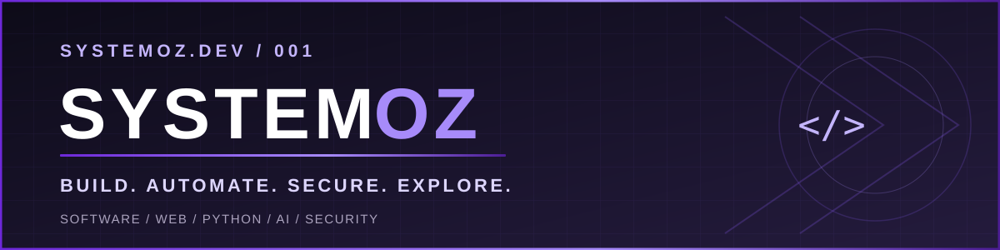

# Hi, I'm SystemOz 👋

**Software Developer · Web Development · Python & Automation · AI · Ethical Cybersecurity**

*Building useful software, exploring emerging technologies, and improving with every project.*

---

## 👨‍💻 About Me

I'm SystemOz, an Information Systems Development graduate with an academic background in software development, web technologies, databases, and mobile applications.

During my studies, I explored technologies including Python, Java, C#, HTML, CSS, databases, and development frameworks.

I'm passionate about technology and enjoy turning ideas into functional applications, exploring solutions, and continuously improving projects.

Artificial intelligence has played an important role in my development journey, helping me experiment with different technologies and bring my ideas to life.

My current goal is to strengthen my programming fundamentals, understand the systems I build, and become a more independent and confident software developer.

My philosophy: Build. Understand. Improve. Explore.

- 🔭 **Currently focused on:** strengthening my portfolio through useful, well-documented projects.
- 🧠 **Exploring:** AI-powered applications, automation workflows, and secure software practices.
- 🛠️ **Approach:** build, test, document, refactor, and keep improving.
- 🤝 **Open to:** constructive feedback and learning through collaboration.

## 🧭 Areas of Interest

| Area | What interests me |
| --- | --- |
| 🌐 Web Development | Building responsive and accessible web experiences |
| 🐍 Python & Automation | Creating scripts and tools that simplify workflows |
| 🛡️ Ethical Cybersecurity | Learning defensive security and secure coding practices |
| 🤖 Artificial Intelligence | Exploring practical AI integrations and applications |
| ⚙️ Software Development | Designing maintainable, reliable applications |
| 🔍 Continuous Exploration | Experimenting with new tools and technologies |

## 🧰 Technologies & Tools

**My focus areas include the technologies below.** This is a roadmap and set of interests—not a claim of expert-level proficiency in every tool.

> **Before publishing:** remove any badge for a technology you haven't used yet, or move it to a personal learning roadmap.

## 🚀 Project Roadmap

These are **planned portfolio projects**, not completed work. I'll link them here once they're built and publicly available.

| Project | Goal | Status |
| --- | --- | --- |
| **Developer Portfolio** | Responsive personal website showcasing my work | 🗓️ Planned |
| **Python Automation Toolkit** | Small, reusable scripts for everyday workflows | 🗓️ Planned |
| **Task Manager App** | Full-featured task tracking with clean UI | 🗓️ Planned |
| **AI Learning Lab** | Documented experiments with practical AI use cases | 🗓️ Planned |
| **Secure Coding Notes** | Defensive security notes and safe coding demonstrations | 🗓️ Planned |

## 📚 How I Work

1. **Understand** the problem and define a small, testable goal.
2. **Build** an initial solution with readable, organized code.
3. **Test** expected behavior and handle common failures.
4. **Document** setup instructions, design decisions, and limitations.
5. **Improve** based on what I learn and feedback I receive.

## 📊 GitHub Activity

> The activity card is provided by a third-party service and may occasionally be unavailable. Remove this section if you prefer a minimal, self-contained README.

## 🌱 What's Next?

My goal is to keep growing as a developer by shipping real projects, learning from experience, and writing software that is useful, understandable, and secure.

---

**Thanks for visiting!** ✨

*Build • Automate • Secure • Explore*

